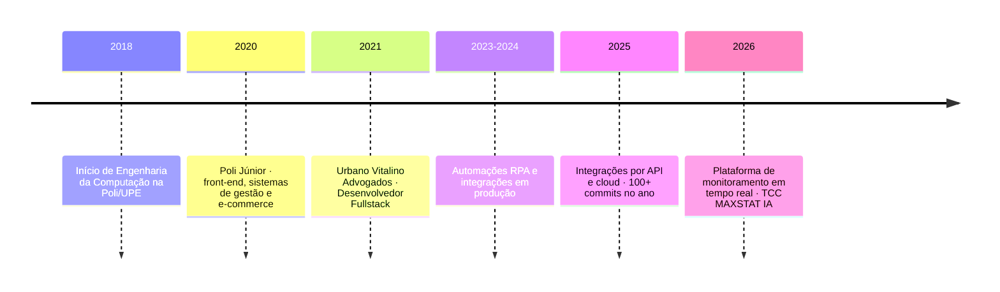
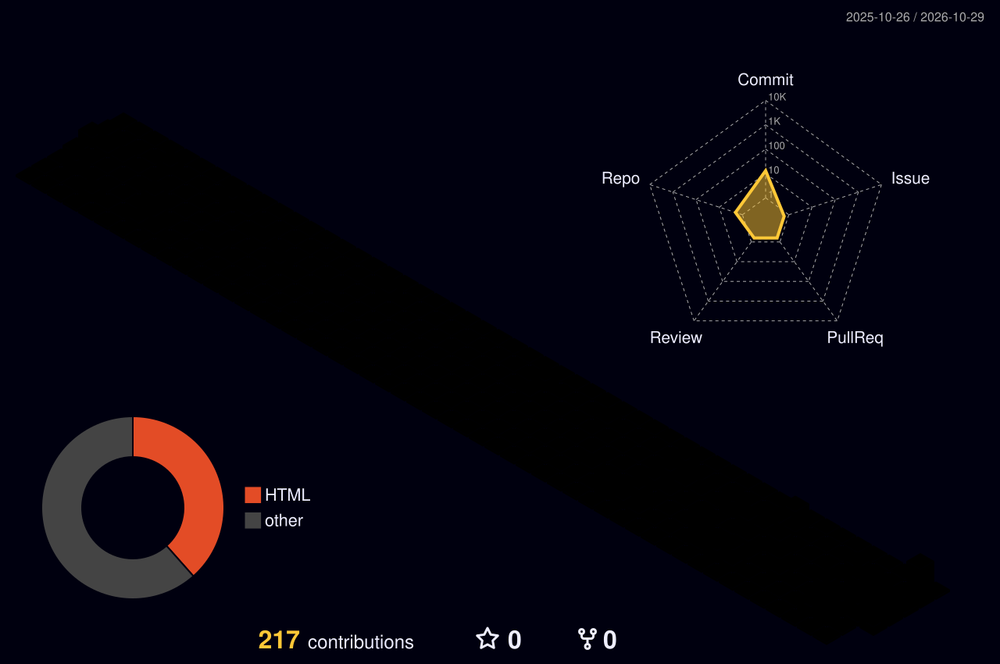

**Victor Guilherme Barros** · Desenvolvedor Fullstack na [Urbano Vitalino Advogados](https://github.com/Urbano-Vitalino-Advogados) · Engenharia da Computação na Poli/UPE · Recife, PE

---

### `$ whoami`

Desenvolvedor fullstack há mais de 5 anos, cuidando do ciclo inteiro: levantamento de requisitos, código, deploy e sustentação em produção. Meu foco são **automação de processos (RPA e web scraping)**, **integrações entre sistemas** e **aplicações web em tempo real**, com Python no back-end e React no front-end.

  

---

### 🧠 O que eu aplico no dia a dia

  

---

### 🧰 Stack

**Linguagens** 

**Back-end** 
 

**Automação e dados** 

**Front-end** 

**Infra e ferramentas** 

---

### 🛠️ Projetos em destaque

| Projeto | O que é | Tecnologias e conceitos |
|---|---|---|
| **RPA Monitor** | Central de monitoramento em tempo real das automações da empresa | Django, DRF, Channels (WebSocket), React, TypeScript, Tailwind, observabilidade, reconciliação de dados |
| **Robôs RPA** | Família de automações de cadastro e coleta de dados em sistemas externos | Selenium, Playwright, Celery, Redis, PostgreSQL, Docker, retentativas e idempotência |
| **SpiderJUS** | Coleta de andamentos processuais em lote em portais de tribunais | Playwright, Celery, AWS ECS e S3, paginação, detecção de bloqueio |
| **Integrações por API** | Sincronização automática de dados entre sistemas internos e de parceiros | REST, Celery Beat, Lambda, processamento de planilhas e PDFs |
| **MAXSTAT IA** · *TCC* | Plataforma de rastreabilidade de processos de fermentação industrial | DRF, React, Server-Sent Events, Knox, integração com equipamentos, Docker e executável desktop |
| [**simulado-cpa**](https://github.com/VictorBarros28/simulado-cpa) | Simulado gamificado da certificação CPA da ANBIMA | HTML, CSS e JavaScript puros, arquivo único |

<b>🧪 Mais sobre o MAXSTAT IA</b>

 

Meu TCC de Engenharia da Computação. É uma aplicação full-stack que substitui registros manuais de laboratório por um fluxo digital e auditável:

- reúne em uma única interface dados vindos de dois equipamentos diferentes, um por leitura de arquivos monitorados e outro por API do fabricante;
- avisa o usuário em tempo real (SSE) assim que uma nova leitura chega;
- oferece telas distintas por perfil de usuário, com histórico, filtros, exportação e gráficos;
- é distribuída como executável Windows autocontido ou via Docker Compose.

---

### 🗺️ Trajetória

---

### 📈 Atividade

| Ano | Contribuições |
|:---:|:---|
| 2022 | `▍` 21 |
| 2023 | `▌` 28 |
| 2024 | `██▏` 99 |
| 2025 | `███▊` 171 |
| 2026 | `████` 182 *(até outubro)* |

<picture>
  <source media="(prefers-color-scheme: dark)" srcset="https://raw.githubusercontent.com/VictorBarros28/VictorBarros28/output/snake-dark.svg" />
  
</picture>

A maior parte do meu código vive em repositórios privados da organização. Os gráficos acima contam essas contribuições, mas o código não é público.

---

🇺🇸 <b>English summary</b>

 

Full-stack developer with 5+ years of experience owning the whole cycle, from requirements to production support. I focus on **process automation (RPA and web scraping)**, **system integrations** and **real-time web applications**, using Python, Django, Celery, Redis and PostgreSQL on the back end, React and TypeScript on the front end, and Docker, GitHub Actions and AWS for delivery. Computer Engineering at Poli/UPE, based in Recife, Brazil.

Commits em português, <code>feat:</code> e <code>fix:</code> no começo e o porquê no corpo.

