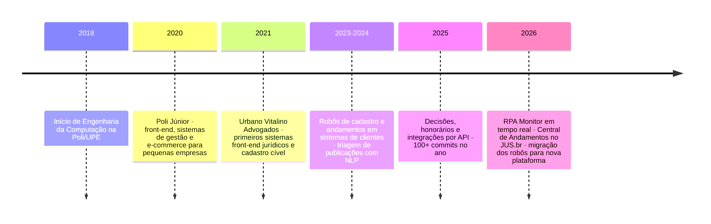
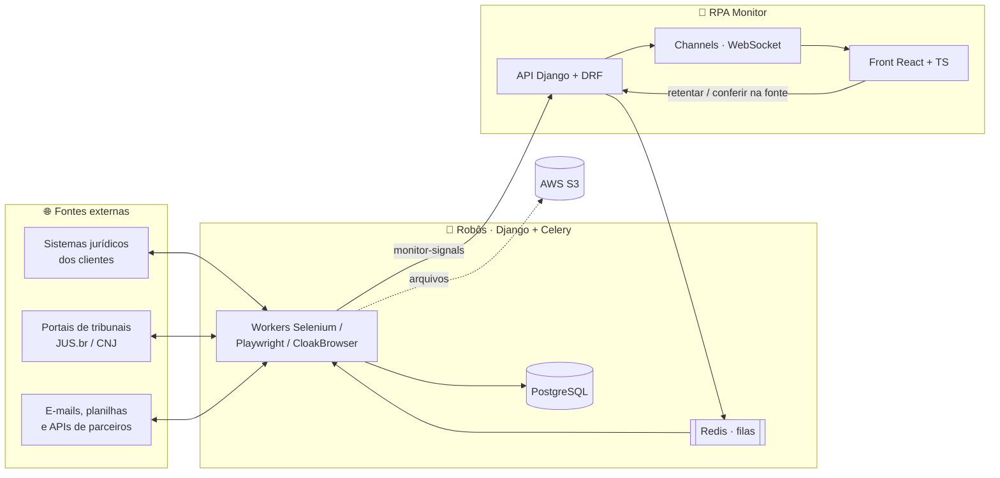

**Victor Guilherme Barros** · Desenvolvedor Fullstack na [Urbano Vitalino Advogados](https://github.com/Urbano-Vitalino-Advogados) · Engenharia da Computação na Poli/UPE · Recife, PE

---

### `$ whoami`

Há mais de 5 anos construo e mantenho, de ponta a ponta (requisito, código, deploy e sustentação), os **robôs RPA e as integrações** que tiram trabalho repetitivo das mãos de advogados. São cadastros de processos, andamentos, diligências, audiências, prazos e honorários, rodando todo dia contra sistemas jurídicos de clientes, portais de tribunais e o JUS.br.

Meu trabalho vai da raspagem que precisa sobreviver a um login com SSO e TOTP à tela em React onde o operador vê, em tempo real, o que deu certo, o que falhou e por quê.

  

---

### 🗺️ Trajetória

---

### 🧭 Como as peças se encaixam

> Diagrama interativo: dá para ampliar e arrastar direto no GitHub.

---

### 🛠️ Projetos que mais me orgulham

<b>📡 RPA Monitor</b>: central em tempo real de todas as automações do escritório

 

Back em **Django + DRF + Channels** e front em **React 19 + TypeScript + Vite + Tailwind + Radix + Framer Motion**. Mais de 20 operações de clientes reportam ali via um pacote interno (`monitor-signals`) que instrumenta cada robô.

- **Conferir na fonte**: compara o volume processado pelo robô com o que existe na origem e explica cada diferença (lançamento tardio, já processado, fora do critério). Virou o padrão de validação das automações.
- **Retentar pelo front**: refaz busca, download e envio para um item ou uma rodada inteira, preservando período e horário da execução original.
- Sincronização automática de planilhas, grupos de acesso por cliente e banner de indisponibilidade quando um portal externo cai.

<b>🕷️ Central de Andamentos (SpiderJUS)</b>: crawler de andamentos no JUS.br

 

Robô em **Playwright + CloakBrowser** que lê andamentos processuais em lote a partir de planilhas, com detecção de bloqueio, paginação, retorno em `.xlsx` e alertas quando a API pública fica instável. Deploy em containers na AWS (ECS).

<b>🔐 Robôs que sobrevivem a login hostil</b>

 

Automação de login com **SSO, TOTP (`pyotp`) e passkey/WebAuthn**, renovação de sessão no meio de rodadas longas, captcha e retentativa por item. Quando o login cai, a mensagem diz em qual passo do SSO ele travou.

<b>🧯 Caso real: a rodada que morria na sexta hora</b>

 

Uma rodada de ~10 mil andamentos terminava sempre com milhares de itens em `Rodada interrompida`. A causa estava em dois lugares:

1. o robô caía inteiro quando o login falhava 3× seguidas num reinício;
2. o "destrave" do monitor tinha um **teto fixo de 6h** e encerrava rodadas legítimas que ainda devolviam linhas.

A correção foi feita nos dois repositórios: login resiliente com diagnóstico por etapa e um destrave que olha **progresso**, não relógio. Depois disso, os itens foram reprocessados com acompanhamento ao vivo pelo monitor.

<b>🧠 Outros</b>

 

- **Publicações**: triagem de publicações jurídicas com NLP (`sentence-transformers`, NLTK) e dados do Redshift.
- **Honorários**: pipeline de faturamento com leitura de e-mail (IMAP), PDFs (PyMuPDF), exportação em XLSX e AWS Lambda.
- **Integrações por API**: cadastro automático de processos entre o sistema do escritório e plataformas de parceiros, com Celery Beat e reprocessamento por data.
- [`simulado-cpa`](https://github.com/VictorBarros28/simulado-cpa): simulado gamificado da certificação CPA da ANBIMA, em um único HTML, com XP e sequências.

---

### 🧰 Stack do dia a dia

**Back-end e automação** 

**Front-end** 

**Infra** 

---

### 📈 Atividade

| Ano | Contribuições |
|:---:|:---|
| 2022 | `▍` 21 |
| 2023 | `▌` 28 |
| 2024 | `██▏` 99 |
| 2025 | `███▊` 171 |
| 2026 | `████` 182 *(até outubro)* |

<picture>
  <source media="(prefers-color-scheme: dark)" srcset="https://raw.githubusercontent.com/VictorBarros28/VictorBarros28/output/snake-dark.svg" />
  
</picture>

A maior parte do meu código vive em repositórios privados da organização. Os gráficos acima contam essas contribuições, mas o código não é público.

---

🇺🇸 <b>English summary</b>

 

Full-stack developer with 5+ years at a Brazilian law firm, building and running **production RPA and integrations** with Python, Django, Celery, Redis, PostgreSQL, Selenium and Playwright, plus a **real-time monitoring platform** (Django Channels + React/TypeScript) that tracks every automation, reconciles processed volume against the source and lets operators retry from the UI. Computer Engineering student at Poli/UPE, based in Recife, Brazil.

Commits em português, <code>feat:</code> e <code>fix:</code> no começo e o porquê no corpo.

